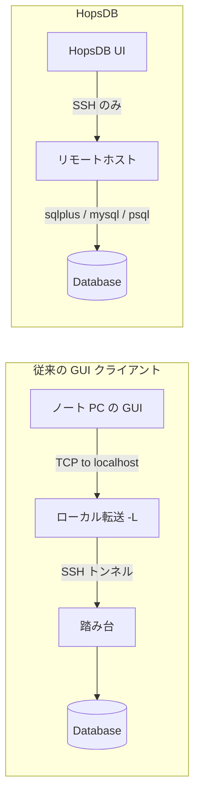

# HopsDB

[English](README.md) · [简体中文](README.zh-CN.md)

Tauri 2、React、TypeScript、Rust で作った **SSH 優先**のデスクトップ DB クライアントです。
SSH ホストに接続し、その上のデータベース CLI を起動して、デスクトップ UI で SQL や結果を扱います。
ローカルの DB ドライバで直接つなぐクライアントではありません。

**現状は早期 alpha です。** まず隔離した検証環境と最小権限のアカウントで使ってください。
本番の機密システムに繋ぐ前に [セキュリティ上の制限](SECURITY.md) を読んでください。現時点では本番利用は推奨しません。

## なぜ HopsDB か

多くの GUI DB クライアントは、データベースまでの **TCP 経路**を前提にします。よくあるのは SSH の
**ローカルポートフォワード**（`ssh -L`）で、`localhost:1521` などを内製 DB に届けるやり方です。次のような環境ではそれが使えません。

- ネットワークやセキュリティポリシーで **ポートフォワードが禁止**されている
- 踏み台 / アプリ機には SSH できるが、**DB ポートをローカルに出せない**
- DB がリモート（やコンテナ）内の **`127.0.0.1` だけ**を聞いていて、手元からそのポートに届かない

HopsDB は別の道を取ります。普通の **SSH セッション**を保ったまま、リモートで
`sqlplus` / `mysql` / `psql` を動かし、CLI の出力をデスクトップの SQL UI にします。
**ローカルの DB ポートフォワードは不要です。** 飛び越える必要があるときは、ネストした SSH にも対応します。




## 機能

- **ローカルポートフォワード不要** — トンネルが封じられている／使えないときも、SSH 経由でリモート CLI から SQL
- 保存した SSH 接続と、ネスト SSH を含む複数行の起動コマンド
- 独立した接続ワークスペースと複数の SQL タブ
- SQL 編集・補完・整形、結果列のリサイズ、CSV / Excel エクスポート
- オブジェクト閲覧とソース／定義タブ（DB ごとに対応範囲は異なる）
- リモートシェル向けの行単位 Command ビュー

## データベース対応

| データベース | リモートクライアント | 現状 |
| --- | --- | --- |
| Oracle | `sqlplus` | いちばん検証が進んでいる経路。ローカル統合テストあり |
| MySQL / MariaDB | `mysql` など | プロンプト検出と HTML 結果パース。オブジェクト周りは発展中 |
| PostgreSQL | `psql` | プロンプト検出と HTML 結果パース。検証は相対的に少なめ |

どの DB が有効かは、クライアントのデフォルトプロンプトから判定します。SSH が繋がっただけでは DB 準備完了とはみなしません。
`SQL>`、`mysql>`、`MariaDB [db]>`、`db=>` などのデフォルトプロンプトは変えないでください。カスタムや継続プロンプトだと SQL ビューの自動判定が外れることがあります。機能の揃い方はまだ DB ごとに差があります。

## 必要条件

- Node.js 22.13+（22.x）または Node.js 24+、および npm。`.nvmrc` は Node 22 を指定します
- 現行の安定版 Rust ツールチェーン（Cargo 含む）
- [Tauri 2 のプラットフォーム前提](https://v2.tauri.app/start/prerequisites/)：macOS は Xcode Command Line Tools、Windows は C++ Build Tools と WebView2、Linux は WebKitGTK 4.1 など
- 到達可能な SSH サーバーと、そのホスト（または SSH で入るコンテナ）上の適切な DB クライアント。HopsDB はサーバーやリモートクライアントをインストールしません

ローカル検証の主戦場は macOS です。CI は macOS / Windows / Linux のデスクトップコンパイルを見ますが、全プラットフォームのランタイム互換を保証するものではありません。

## ローカル実行

公開リポジトリのルートとなるこのディレクトリで:

```sh
npm ci
npm run tauri dev
```

Vite が `http://localhost:1420` で立ち上がり、デスクトップ窓が開きます。初回の Rust ビルドは数分かかることがあります。UI だけなら `npm run dev` でも構いませんが、普通のブラウザでは SSH・DB・デスクトップエクスポートは使えません。

## 初めての接続

1. 接続を作り、SSH のユーザー名・ホスト・ポートを入れる
2. 起動コマンドを 1 行ずつ追加する。これらは **最初の SSH ホスト上**で実行され、デスクトップアプリのマシン上とは限りません
3. パスワードが必要なステップは、コマンド文に埋めず、その行の `Pwd` 欄を使う。alpha ではこれらも暗号化せず保存されます（[SECURITY.md](SECURITY.md)）
4. 接続する。認識された DB プロンプトなら SQL ビューが開き、そうでなければ Command ビューの出力を確認する

使い捨て環境向けの MySQL 例:

```sh
mysql --html -u demo -p -D demo_db
```

デモ DB のパスワードはその行の `Pwd` に入れること。MySQL は SSH ホストから既に使える状態である必要があります。現行の MySQL 結果パーサは HTML 出力前提なので、起動時に `--html` を付けてください。公開バグ報告に実ホスト名・認証情報・クエリデータを載せないでください。

## 開発と検証

```sh
npm run typecheck
npm test
npm run build
cargo test --manifest-path src-tauri/Cargo.toml --locked
```

`npm run test:watch` はフロントのウォッチモードです。デフォルトの Rust テストは実 DB に繋がりません。ローカル Oracle 統合／シード系は ignored です。オプトイン前に [統合テスト案内](docs/TESTING.md) を読んでください（シードはデモ表を drop / 再作成します）。

[CI ワークフロー](.github/workflows/ci.yml) はこのディレクトリをリポジトリルートとみなします。フロント検証と Rust テスト、未署名デスクトップ実行ファイルのコンパイルまで行い、インストーラ公開やクラウド／DB 認証情報は使いません。

## ローカルビルド

```sh
npm run tauri -- build
```

プラットフォームごとの成果物は `src-tauri/target/release/`、インストーラがある場合は `bundle/` 配下です。署名・公証・公式インストーラ配布には追加設定が必要で、このソースリポジトリ単体では署名済み公式ダウンロードを約束しません。

## 既知の制限

- SSH サーバー鍵は現状検証せず受け入れることがあり、ネスト時のホスト鍵確認も自動承認され得ます（[SECURITY.md](SECURITY.md)）
- 保存した接続プロファイルに平文パスワードが含まれます。コマンドに書いたパスワードが Command ビュー履歴に出ることもあります
- Command ビューは端末エミュレータではありません。ユーザー起動の Ctrl+C / Stop はなく、アイドル中の連続ストリームもありません
- 起動完了はプロンプト一致と短いアイドル待ちです。遅いネスト接続や `gc` / `gcloud` のようなラッパだと、ステップが早すぎることがあります
- デスクトップ WebView に CSP は未設定です
- UI の書き込みモード切替は DB の認可境界ではありません。読み取り専用は DB 権限で、SQL 実行前にはバックアップを

## プロジェクト構成

```text
src/                       React UI と Tauri コマンドラッパ
src/components/             接続フォーム、SQL エディタ、オブジェクトツリー、Command ビュー
src-tauri/src/              Rust の SSH セッション、SQL アダプタ、エクスポート
src-tauri/tests/            任意のローカル Oracle 統合テスト
.github/                    CI と貢献用テンプレート
docs/                       テスト・公開ガイド
```

このディレクトリが、公開リポジトリ向けのスタンドアロンアプリ本体です。

## コントリビュートとセキュリティ

変更と PR は [CONTRIBUTING.md](CONTRIBUTING.md)、脆弱性報告は [SECURITY.md](SECURITY.md) を見てください。
初回の公開リポジトリ準備は [公開チェックリスト](docs/PUBLISHING.md) に従ってください。

## ライセンス

HopsDB は [Apache-2.0](LICENSE) です。条件の範囲で商用利用できます。
サードパーティはそれぞれのライセンスに従います。[NOTICE](NOTICE) と
[THIRD_PARTY_NOTICES.md](THIRD_PARTY_NOTICES.md) を参照してください。
Apache-2.0 は商標権を付与せず、フォークへの支持を意味しません。
