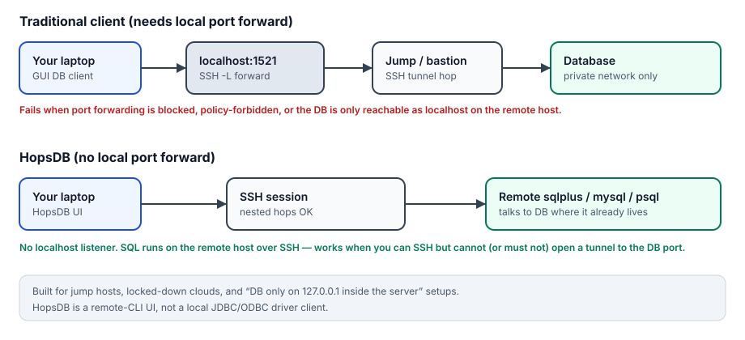
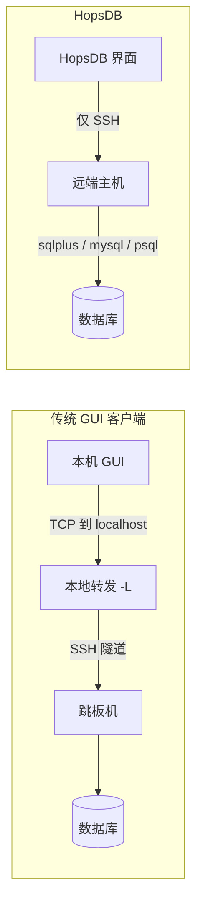

# HopsDB

[English](README.md)

基于 Tauri 2、React、TypeScript 和 Rust 的 SSH 优先桌面数据库客户端。
先连接 SSH 主机，再进入该主机上的数据库命令行客户端，在桌面界面中编辑 SQL、
查看结果与浏览对象；它不是通过本地数据库驱动直接连接数据库的工具。

**当前为早期 alpha。** 请先使用隔离测试环境和最小权限账号。
当前仍有主机密钥未验证、密码明文持久化等限制，不建议用于敏感生产环境，
详情见 [安全说明](SECURITY.md)。

## 为什么用 HopsDB

多数图形化数据库客户端默认要有一条到数据库的 **TCP 通路**，常见做法是开 SSH
**本地端口转发**（`ssh -L`），让本机 `localhost:1521` 之类端口打到内网库。下面这些情况就会卡住：

- 网络或安全策略 **禁止端口转发**
- 只能 SSH 上跳板 / 应用机，**不能**把数据库端口映射到本机
- 数据库只监听远端主机（或容器）里的 **`127.0.0.1`**，本机根本连不上那个端口

HopsDB 换了一条路：保持普通 **SSH 会话**，在远端直接跑 `sqlplus` / `mysql` / `psql`，
再把命令行结果做成桌面 SQL 界面。**不需要本机做数据库端口转发。** 需要多跳时，也支持嵌套 SSH。





## 功能与数据库支持

- **无需本机端口转发** — 在禁止或无法做隧道的网络里，通过 SSH 在远端跑数据库 CLI。
- 保存连接、按行执行启动命令，支持嵌套 SSH 工作流。
- 多连接工作区、多 SQL 标签页、补全、格式化和结果列宽调整。
- 数据库对象浏览、定义查看、CSV 和 Excel 导出。
- 按行发送命令的 Command view；它不是完整终端。

Oracle（`sqlplus`）是验证最多的路径；MySQL / MariaDB 和 PostgreSQL（`psql`）
已有提示符识别与 HTML 结果解析，但各数据库的功能和验证程度尚不一致。
请保留 `SQL>`、`mysql>`、`MariaDB [db]>`、`db=>` 等默认客户端提示符，
自定义提示符可能导致 SQL 视图无法自动识别。

## 安装与启动

需要 Node.js 22.13+（22.x）或 24+、npm、当前稳定版 Rust/Cargo，以及
[Tauri 2 对应平台的构建依赖](https://v2.tauri.app/start/prerequisites/)：
macOS 需要 Xcode Command Line Tools；Windows 需要 C++ Build Tools 和 WebView2；
Linux 需要 WebKitGTK 4.1 等系统依赖。

在本目录执行（未来独立仓库的根目录）：

```sh
npm ci
npm run tauri dev
```

命令会启动 Vite 并打开桌面窗口，首次 Rust 编译可能需要几分钟。
`npm run dev` 只能预览界面，浏览器中不能使用 SSH、数据库和桌面导出功能。
本地主要验证平台为 macOS；配置了 Windows、Linux、macOS 编译 CI，
不代表所有平台的运行时功能均已完整验证。

## 配置连接

1. 新建连接，填写第一跳 SSH 的用户名、主机与端口。
2. Command set 每行一条命令，命令在第一跳 SSH 主机上执行。
3. 需要密码的命令优先使用该行的 `Pwd` 字段，不要把密码写在命令里。
   注意：当前 `Pwd` 和 SSH 密码仍会明文保存在本机配置中。
4. 点击连接；识别到数据库默认提示符后进入 SQL 视图，否则查看 Command view。

例如，已在 SSH 主机上准备好 MySQL 客户端与隔离测试库时：

```sh
mysql --html -u demo -p -D demo_db
```

把测试数据库密码填到该行 `Pwd` 字段。当前 MySQL 结果解析需要启动参数 `--html`。
数据库服务和远端客户端需要自行准备，HopsDB 不负责安装它们。

## 测试与构建

```sh
npm run typecheck
npm test
npm run build
cargo test --manifest-path src-tauri/Cargo.toml --locked
```

`npm run test:watch` 用于前端测试监听。默认测试不会连接真实数据库。
Oracle 集成和演示数据测试默认跳过，手动运行前阅读 [测试说明](docs/TESTING.md)，
其中演示数据脚本会删除并重建测试表。

构建桌面程序：

```sh
npm run tauri -- build
```

产物位于 `src-tauri/target/release/`，安装包通常位于其 `bundle/` 子目录。
签名、公证和正式安装包发布需要额外配置，当前仓库不承诺提供已签名的官方下载。

## 已知限制

- SSH 尚未验证服务器密钥，嵌套连接的密钥确认也可能自动接受。
- 连接密码明文保存，写在命令中的密码还可能出现在界面历史中。
- Command view 没有用户可触发的 Ctrl+C/Stop，也不会在空闲时持续刷新输出。
- 启动步骤依赖提示符和短暂空闲判定；较慢的嵌套连接、`gc` / `gcloud` 等包装命令
  可能导致过早执行下一步。
- 桌面 WebView 尚未配置 CSP；界面的写入开关也不能替代数据库权限。

完整风险与报告方式见 [SECURITY.md](SECURITY.md)。

## 参与和许可

贡献指南：[CONTRIBUTING.md](CONTRIBUTING.md)。
建立新公开仓库前：[发布清单](docs/PUBLISHING.md)。

项目采用 [Apache-2.0](LICENSE)，允许按协议商用。
第三方组件遵循各自许可证，见 [NOTICE](NOTICE) 和
[THIRD_PARTY_NOTICES.md](THIRD_PARTY_NOTICES.md)。该协议不授予商标使用权，
也不表示维护者为衍生版本背书。
